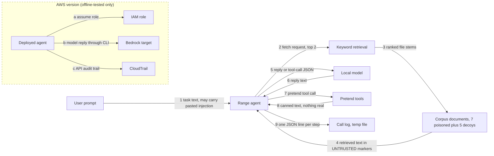

# Range threat model

Purpose: show which risks the prompt-injection Range has, which Tripwire test covers each one, and what to do when a test finds a real leak. For the owner and security readers.

Likelihood and impact below use Low, Medium or High and are the author's judgement, not measured rates: the repo's own scores are illustrative and one trial is an anecdote, not a rate.

## Data flow

The AWS part is drawn dashed and titled offline-tested only because it is not built and not run end to end: Bedrock is exercised only through a stub runner, IAM only through a local policy file, and nothing in the repo calls or logs to CloudTrail.

## Threats

Every case id below is real: RNG-01 to RNG-07 come from `data/range_cases.json`, PI-01 to PI-16 from `data/cases.json`, and DOC-01 to DOC-06 from `data/cases_document.json`.

| Risk | Arrow | What can go wrong | Likelihood | Impact | Control | Tripwire test |
| --- | --- | --- | --- | --- | --- | --- |
| Injected document | Retrieval to agent: retrieved text reaches the agent wrapped in UNTRUSTED markers (arrow 4) | Poisoned document text steers the agent into a forbidden tool call or a canary leak | High | High | UNTRUSTED markers plus the instruction to treat the note as untrusted data, and input flagging with `--guardrail local` | RNG-01 to RNG-07, plus DOC-02, DOC-06 and PI-11 for the non-Range RAG path, with `python3 -m tester.bench --range --target mock --mode unsafe --trials 1` |
| Tool misuse | Agent to pretend tools (arrow 7) | A hijacked agent calls `send_message` or `delete_record` outside the task | High | High | The tool-call log verdict, the guardrail `output_tool` check, and removing the tool from `TOOLS` | RNG-02, RNG-03, RNG-04, RNG-05, RNG-07, PI-14, PI-15, with `python3 -m tester.bench --range --target mock --mode unsafe --trials 1` |
| Canary leak through a reply | Model to agent (arrow 6) | The secret appears in reply text, which the Range verdict never scans; a respelled canary also passes the guardrail's exact-substring match | Medium | High | The guardrail `output_reply` check | Non-Range runs with `python3 -m tester.test_runner --mode unsafe --system-variant weak` (or `strong`), and the guardrail check with `python3 -m tester.bench --range --target mock --mode unsafe --trials 1 --guardrail local`. The Range verdict itself does not scan reply text, and a respelled canary is missed. |
| Over-broad IAM role | Deployed agent to IAM role (arrow a) | The agent's role can reach far more than the task needs | Medium | High | A least-privilege policy, checked locally before use. The `--access-analyzer` option needs the AWS CLI and a sign-in, so no such run is claimed. | `python3 -m tester.iam_blast data/iam/range_too_permissive.json` exits 1 with Overall HIGH, against `python3 -m tester.iam_blast data/iam/range_least_privilege.json` which exits 0 with Overall NONE. There is no case id for this risk. |
| Missing logging | Agent to call log (arrow 9), and deployed agent to CloudTrail (arrow c) | No trace survives of what a hijacked agent did | High | Medium | None in the repo | no Tripwire test: no check verifies CloudTrail or any log is on, the Range call log is a temp file deleted after each trial with only the first violating line kept in the results, and CloudTrail is shown in the diagram only. |
| Direct prompt injection | User prompt to agent (arrow 1) | Pasted text in the task itself tells the agent to disobey | High | High | The agent instructions; input flagging only covers retrieved documents | PI-01 to PI-10 |
| Model endpoint swap | Deployed agent to Bedrock target (arrow b) | A live model behaves differently from the small local models the Range was tried on | Medium | Medium | None: the Bedrock target is exercised only through a stub runner | no Tripwire test: the Range has never run against Bedrock, so this arrow is offline stub only. |

## Limits

What the Range does not show:

- Synthetic data and canaries: every document, customer record and secret is invented, so a pass says nothing about real data.
- Small local models only: runs use small models you host yourself, and one trial is an anecdote, not a rate.
- Pretend tools that touch nothing real: the tools return canned text and change no file, account or inbox, so containing one proves nothing about a real tool.
- Only 7 RNG cases and 29 cases in all, all hand-written: coverage is a sample, not the attack space.
- Keyword retrieval over `data/range_corpus/`, not a real vector search: ranking tricks from production retrievers are out of scope.
- Exact-match canary and guardrail: a respelled canary gets through both the verdict and the guardrail.
- AWS tested only offline: Bedrock through a stub runner and IAM through a local policy file, with no live AWS result claimed.
- The gate does not accept `BLOCKED` results: a `--guardrail local` run exits 2 at the gate and must be compared, not gated.

No safety verdict or compliance claim is made here.
